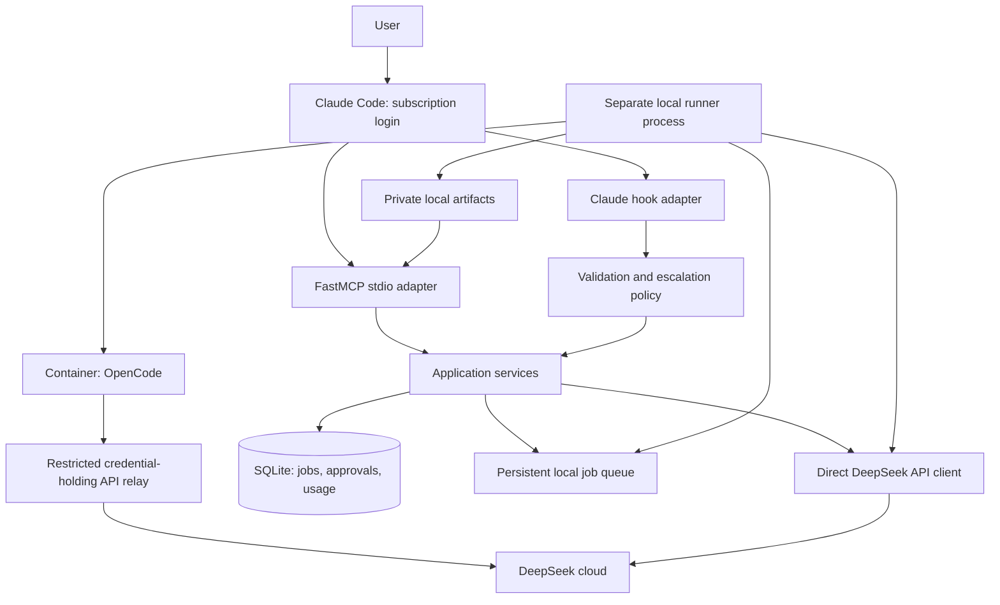

# Architecture

Status: proposed design. Component boundaries and enforcement mechanisms require validation before implementation.

## Roles and boundaries

| Role | Inputs | Authority | Output |
| --- | --- | --- | --- |
| Consultant | Task, selected files/diff, optional conversation ID | Text inference only | Recommendations, alternatives, risks |
| Coding worker | Immutable base commit, task, acceptance criteria | Edit a disposable sandbox workspace and run bounded commands | Patch, verification evidence, handoff |
| Security researcher | Scoped brief, approved evidence, research state | Passive text analysis only in v1 | Findings, evidence references, hypotheses, next steps |

Claude reviews all external findings and owns integration. Research does not provide shell tools, browse autonomously, scan hosts, execute exploits, or modify a target. Without a retrieval tool, references returned by a model remain unverified until checked independently.

The credential relay is a narrow worker-isolation component. It accepts only the job's allowed DeepSeek API operations, enforces limits, and strips credentials from logs. The consultant can call DeepSeek directly. Container runtime, host bridge, and owner account are trusted; repository code, model output, and worker processes are untrusted.

## Processes and modules

The CLI and MCP entry points share application services. They validate typed requests, apply policy, persist intent, and return bounded structured results. MCP stdout is reserved for protocol messages; diagnostics go to stderr with redaction.

A separately managed runner claims queued jobs with transactional leases and heartbeats. It survives the originating Claude turn or MCP process exiting. Hooks enqueue locally and return promptly; they never wait on cloud calls or launch detached workers. Use an operating-system service manager to supervise the runner. Only one runner owns execution, even with multiple MCP clients.

Use the Anthropic Python SDK against DeepSeek's compatible endpoint for consultant/research requests. Preserve complete provider message blocks when continuing conversations. Validate model and effort capabilities, enforce explicit input/output limits, and bound transient-error retries by the request deadline. Do not silently downgrade unsupported parameters or retry an uncertain charge without recording the ambiguity. Keep provider and OpenCode adapters replaceable.

## Coding job lifecycle and isolation

1. Resolve a configured repository alias, enforce task/size limits, and resolve the base ref to an immutable commit. Never import unstaged changes implicitly. Store the request and reserve capacity transactionally.
2. Create a bridge-owned branch/worktree from that commit using argument arrays, generated names, and disabled Git hooks. Do not run repository scripts on the host.
3. Export a clean source snapshot to a disposable container workspace. **Do not mount the host worktree or its `.git` file/common Git directory into the worker.** Linked worktrees otherwise expose or depend on shared host Git metadata. This snapshot-and-collect boundary preserves host worktree management while isolating untrusted execution.
4. Start pinned OpenCode in a non-root container with a read-only root filesystem, writable job workspace and bounded temporary storage, dropped capabilities, no privilege escalation, and CPU/RAM/process/time/output limits. No home directory, SSH agent, cloud credentials, Docker socket, or host Git configuration is mounted. Disable inherited OpenCode plugins, MCP servers, auto-updates, and user configuration; inspect the effective configuration for repository overrides.
5. Permit network only to the job API relay through an enforced network boundary. No direct internet route or DNS-only allowlist. Prebuild approved dependencies; dependency downloads need an explicit policy exception. Verify this on every supported container runtime before enabling workers.
6. Stop the agent and freeze its output before collection. Collect changed/new/deleted files with quotas and path/symlink checks, including untracked files; reject special files and submodule changes initially. Apply the validated delta to the bridge-owned host worktree without executing repository hooks. Keep task instructions and bridge metadata outside the source snapshot.
7. Run configured verification in a fresh network-disabled container. Test commands come from trusted project configuration, never arbitrary model-provided shell strings. Capture command, image digest, exit code, bounded logs, base commit, and output hash. A test can still be inadequate or modified by the worker; Claude must inspect the patch and test quality.
8. Generate the diff, changed-file list, and handoff independently. Preserve failed/partial output for review. An optional bridge-owned commit is permitted after collection; workers cannot merge, push, or deploy. Default delivery is a patch.

Resource proposals: one worker by default, configurable up to three; 1,800-second default timeout, 3,600-second maximum; two CPUs and 4 GiB RAM initially. Benchmark rather than assume these are sufficient.

## Persistence, recovery, and artifacts

Store runtime data outside repositories in a private owner-only application state directory; use SQLite WAL, foreign keys, versioned migrations, short transactions, and a busy timeout. Proposed tables:

| Table | Key responsibilities |
| --- | --- |
| `jobs` | Immutable request/hash, role, repository/base SHA, state, deadline, lease, attempt |
| `job_events` | Append-only state transitions, redacted errors, timestamps |
| `consultations` / `messages` | Continuation history, provider blocks, retention expiry |
| `approvals` | Request hash, scope/policy version, expiry, decision, local actor |
| `api_usage` | Provider request ID, tokens/cache usage, pricing version, estimate |
| `artifacts` | Relative storage key, size, media type, checksum |
| `verification_runs` | Trusted command/profile, exit status, logs and output hash |
| `escalations` | Session/task/revision identity, unique automatic-handoff key |

Use atomic conditional state updates and a unique deduplication constraint. Publish artifacts through temporary files and atomic rename before referencing them in a final result. Artifacts include `handoff.json`, `summary.md`, `changes.patch` for coding jobs, `test-results.json`, and redacted `events.jsonl`.

On restart reconcile leases with bridge-labelled containers. Stop orphaned execution before marking a job `interrupted`; require an explicit retry creating a new attempt. Never blindly rerun a potentially billable request or unfinished coding job. Cancellation first persists intent, then terminates the owned container/process group, waits, and escalates to kill after a grace period. Completion and cancellation race through one transactional terminal-state winner.

Use `null` for unavailable usage, test counts, or cost. Store original usage separately from derived estimates. Prices are versioned inputs; missing prices mean unknown cost. Token/time limits and pre-request reservations reduce spending, but a dollar estimate is not an exact hard cap, particularly during in-flight requests. Preserve whether Claude accepted/rejected a patch as explicit review metadata.

## Context and retention

Resolve only registered repository aliases. Read explicitly selected files within the real repository root, enforce byte/file limits, and reject path traversal, external symlinks, sensitive-file rules, and unsafe file types. Implement race-resistant file opening and copy a bounded snapshot before transmission. Apply the same outbound policy to inline context, diffs, prior messages, and hook envelopes. Secret scanning is an additional filter, not proof that content is safe to send.

Do not send full transcripts by default. Repository text and research-state files can suggest work but cannot grant permissions. Trusted scope configuration lives outside worker-writable directories. Runtime logs exclude keys and full prompts; owner-visible artifacts may contain code and findings and require private permissions. Proposed default retention is 30 days with explicit export/delete and safe worktree cleanup restricted to bridge-owned resources.
