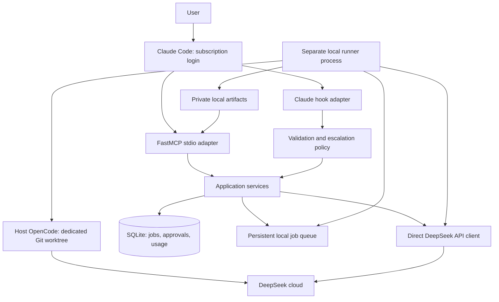

# Architecture

Status: proposed design. Component boundaries and enforcement mechanisms require validation before implementation.

## Roles and boundaries

| Role | Inputs | Authority | Output |
| --- | --- | --- | --- |
| Consultant | Task, selected files/diff, optional conversation ID | Text inference only | Recommendations, alternatives, risks |
| Coding worker | Immutable base commit, task, acceptance criteria | Edit a dedicated host worktree and run local commands | Patch, verification evidence, handoff |
| Security researcher | Scoped brief, approved evidence, research state | Passive text analysis only in v1 | Findings, evidence references, hypotheses, next steps |

Claude reviews all external findings and owns integration. Research does not provide shell tools, browse autonomously, scan hosts, execute exploits, or modify a target. Without a retrieval tool, references returned by a model remain unverified until checked independently.

OpenCode runs directly on the host under the account that starts the runner and calls DeepSeek directly. Each job has its own Git worktree, working directory, process group, configuration, and logs. Local toolchains, dependency caches, and explicitly selected local services remain available without copying source into another execution environment.

Worktrees provide change separation, not a filesystem or security sandbox. Host operating-system protections still apply, but the worker can access files and shared Git metadata available to its account. OpenCode permissions and controlled configuration guide execution; they do not establish an OS-enforced boundary. Use this backend for trusted repositories and tasks. The bridge's context allowlist governs its own API requests; it cannot guarantee that a host coding process reads or transmits only those files.

## Processes and modules

The CLI and MCP entry points share application services. They validate typed requests, apply policy, persist intent, and return bounded structured results. MCP stdout is reserved for protocol messages; diagnostics go to stderr with redaction.

A separately managed runner claims queued jobs with transactional leases and heartbeats. It survives the originating Claude turn or MCP process exiting. Hooks enqueue locally and return promptly; they never wait on cloud calls or launch detached workers. Use an operating-system service manager to supervise the runner. Only one runner owns execution, even with multiple MCP clients.

Use the Anthropic Python SDK against DeepSeek's compatible endpoint for consultant/research requests. Preserve complete provider message blocks when continuing conversations. Validate model and effort capabilities, enforce explicit input/output limits, and bound transient-error retries by the request deadline. Do not silently downgrade unsupported parameters or retry an uncertain charge without recording the ambiguity. Keep provider and OpenCode adapters replaceable.

## Coding job lifecycle on the host

1. Resolve a configured repository alias and immutable base commit, validate the task and limits, and persist the request. Never import uncommitted changes implicitly.
2. Create a bridge-owned branch and dedicated worktree using generated names and argument arrays. Disable Git hooks for bridge-managed Git commands. Preserve the original checkout and keep task instructions/logs outside the tracked source tree.
3. Launch a pinned OpenCode executable directly in that worktree as a separate process group. Use an explicit environment allowlist, the required DeepSeek credential, per-job configuration, and bounded JSON event capture. Do not forward unrelated credential variables or agent sockets. This reduces accidental inheritance; it does not make other account-readable credentials inaccessible.
4. Configure OpenCode's read/edit/command permissions for the scoped task and disable unattended permission prompts. Inspect effective configuration, including repository rules, plugins, and MCP servers; reject unapproved configuration extensions before starting. No automatic push, merge, deploy, or privileged command is authorized. These are application-level controls, not protection against arbitrary code running with account permissions.
5. Use the host toolchain and approved dependency/test profiles. Document any worktree-specific dependency setup and explicitly selected shared caches, files, or local services. Store generated dependency/build files in the job worktree where possible; record shared resources that may cause contention. Do not create implicit symlinks into the original checkout. Network access follows host configuration; no bridge-enforced egress restriction is claimed.
6. Stop OpenCode before verification and inspect the worktree against the recorded base. Independently collect tracked changes, new/deleted files, file modes, binary changes, and unexpected symlinks/submodules. Keep output quotas and validate artifact paths. Do not execute model-provided collection commands.
7. Run trusted verification command argv on the host in the job worktree as a separately tracked process group. Record executable/tool versions, environment profile, working directory, timestamps, exit code, bounded logs, and output hash. Model-supplied test claims are not verification evidence. Inspect altered tests and check that the original checkout's recorded status/content is unchanged; this detects changes in the verification fixture but is not an access-control guarantee.
8. Generate the patch, changed-file list, and handoff independently, including new files and partial output on failure. Default delivery is a patch. An optional bridge-owned commit can be made after verification with hooks disabled; integration remains a separate review action.

Default limits: one worker, configurable up to three; 1,800-second default timeout and 3,600-second maximum; bounded logs/artifacts and model-token budgets. Host CPU and RAM are shared; no container-style hard CPU/RAM quotas are promised. Jobs sharing local services or caches require scheduling constraints or repository-specific coordination.

## Persistence, recovery, and artifacts

Store runtime data outside repositories in a private owner-only application state directory; use SQLite WAL, foreign keys, versioned migrations, short transactions, and a busy timeout. Proposed tables:

| Table | Key responsibilities |
| --- | --- |
| `jobs` | Immutable request/hash, role, repository/base SHA, state, deadline, lease, attempt |
| `job_events` | Append-only state transitions, redacted errors, timestamps |
| `consultations` / `messages` | Continuation history, provider blocks, retention expiry |
| `approvals` | Request hash, scope/policy version, expiry, decision, local actor |
| `api_usage` | Provider request ID, tokens/cache usage, pricing version, estimate |
| `artifacts` | Relative storage key, size, media type, checksum |
| `verification_runs` | Trusted command/profile, exit status, logs and output hash |
| `escalations` | Session/task/revision identity, unique automatic-handoff key |

Use atomic conditional state updates and a unique deduplication constraint. Publish artifacts through temporary files and atomic rename before referencing them in a final result. Artifacts include `handoff.json`, `summary.md`, `changes.patch` for coding jobs, `test-results.json`, and redacted `events.jsonl`.

On restart reconcile leases with recorded worker/verification process identities, start times, and job ownership. Do not kill a process based only on a reused PID; mark uncertain ownership for manual recovery. Stop execution whose ownership is verified before marking a job `interrupted`; require an explicit retry creating a new attempt. Never blindly rerun a potentially billable request or unfinished coding job. Cancellation first persists intent, then terminates the verified job process group, waits, and escalates to kill after a grace period. Completion and cancellation race through one transactional terminal-state winner.

Use `null` for unavailable usage, test counts, or cost. Store original usage separately from derived estimates. Prices are versioned inputs; missing prices mean unknown cost. Token/time limits and pre-request reservations reduce spending, but a dollar estimate is not an exact hard cap, particularly during in-flight requests. Preserve whether Claude accepted/rejected a patch as explicit review metadata.

## Context and retention

Resolve only registered repository aliases. Read explicitly selected files within the real repository root, enforce byte/file limits, and reject path traversal, external symlinks, sensitive-file rules, and unsafe file types. Implement race-resistant file opening and copy a bounded snapshot before transmission. Apply the same outbound policy to inline context, diffs, prior messages, and hook envelopes. Secret scanning is an additional filter, not proof that content is safe to send.

Do not send full transcripts by default. Repository text and research-state files can suggest work but cannot grant permissions. Trusted scope configuration lives outside worker-writable directories. Runtime logs exclude keys and full prompts; owner-visible artifacts may contain code and findings and require private permissions. Proposed default retention is 30 days with explicit export/delete and safe worktree cleanup restricted to bridge-owned resources.
