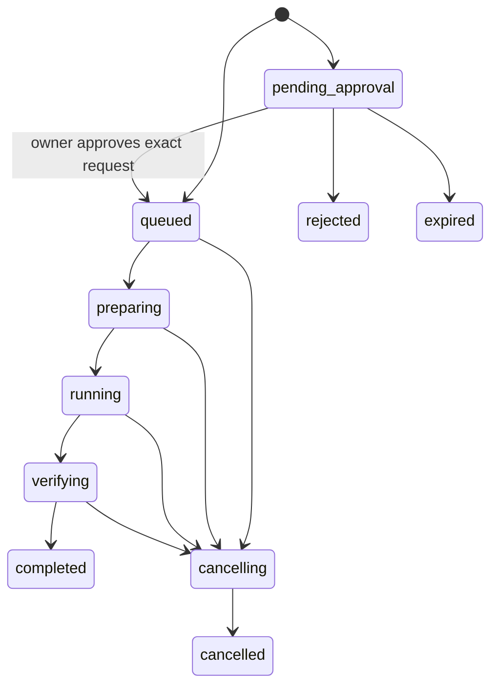

# Proposed contracts

Status: design specification, not an implemented API. Introduce versioned Pydantic models and generated JSON Schemas in M1. Every request uses `schema_version: "1.0"`; reject unsupported versions and unknown security-sensitive fields.

## MCP tools

| Tool | Required input | Optional input / result |
| --- | --- | --- |
| `deepseek_ask` | `task` | `mode` (brainstorm/review/handoff), selected `context`, model alias, effort, output limit, `consultation_id`; structured analysis |
| `deepseek_review` | `task`, selected diff/text/files | model alias, context; findings with severity, location, rationale, recommendation |
| `deepseek_start_job` | repository alias, task, acceptance criteria | base ref (HEAD), constraints, approved verification profile, limits, client request ID; queued coding-job ID |
| `deepseek_job_status` | `job_id` | State, progress, timestamps, usage, sanitized error |
| `deepseek_job_result` | `job_id` | Report and bounded artifact descriptors; never arbitrary filesystem reads |
| `deepseek_cancel_job` | `job_id` | Idempotent cancellation request/result |
| `deepseek_research` | task, `scope_id`, explicit evidence/context | Research state and limits; research-job ID or pending-approval proposal |

The tools cover consultation, coding jobs, and passive research. Approval is intentionally absent from MCP: only the owner's trusted local CLI may approve a pending request. Tool-call identity or an agent's `authorized: true` field never suffices.

Model aliases (`consultant`, `review`, `coding`, `research`) map to configured, verified provider IDs. The initial candidates are `deepseek-flash` and `deepseek-v4-pro`; OpenCode uses provider/model IDs. Unsupported effort settings return `unsupported_capability`. Conversation continuation applies the current outbound policy to previously stored messages too.

Common result envelope:

```json
{
  "schema_version": "1.0",
  "request_id": "opaque-id",
  "status": "completed",
  "data": {"recommendation": "...", "alternatives": [], "risks": []},
  "usage": {"input_tokens": null, "output_tokens": null, "cached_input_tokens": null, "cost_usd_estimate": null},
  "error": null
}
```

Errors carry `code`, sanitized `message`, `retryable`, and optional `job_id`. Codes include `invalid_request`, `out_of_scope`, `approval_required`, `permission_boundary`, `budget_exceeded`, `provider_timeout`, `provider_error`, `sandbox_unavailable`, and `interrupted`. A valid JSON response is not evidence of correct findings. Malformed model reports produce an explicit parse error or labelled raw-text artifact, never fabricated structured claims.

## Job state machine



Every nonterminal execution state can also become `failed`, `timed_out`, or `interrupted` through a recorded transition. Research skips verification execution and instead validates its report before completion. Pending proposals can be cancelled without execution. `completed` means the pipeline finished; `verification.status` independently records passed/failed/not_run/unknown. Terminal states are immutable. Retry creates a new attempt linked to the original job. Pagination/cursors bound event and artifact retrieval.

## Handoff and evidence

Required report fields: schema version, job ID, role, status, task/request hash, actual model ID, summary, findings or changed files, risks, unresolved questions, usage, and artifact descriptors. Coding reports additionally require repository alias, immutable base SHA, optional result SHA, patch checksum, and verification evidence. Findings distinguish `verified`, `model_inference`, and `unverified_reference`.

Each verification entry records trusted command argv, workspace output hash, container image digest, start/end time, exit code, log artifact, and optional parsed test counts. Zero tests and unknown counts differ. Preserve failures and timeouts. A summary supplied by the worker is labelled as such; the bridge computes file lists/diffs and observes verification exit statuses itself.

## Security handoff envelope

```json
{
  "schema_version": "1.0",
  "task_id": "research-17",
  "revision": 1,
  "task_status": "blocked",
  "blocker_type": "technical_uncertainty",
  "role": "security_researcher",
  "scope_id": "approved-project-review",
  "objective": "Explain a failure in the supplied parser sample",
  "attempted_approaches": [],
  "verified_findings": [],
  "open_hypotheses": [],
  "acceptance_criteria": ["Return evidence-backed hypotheses"],
  "context": {"repository": "example-project", "files": ["src/parser.py"]}
}
```

An agent emits exactly one envelope between `DEEPSEEK_HANDOFF_BEGIN` and `DEEPSEEK_HANDOFF_END` in its final response. The hook takes session/agent identity from the event, validates a bounded envelope, resolves trusted task/scope records, and records a canonical hash. It does not search prose for refusal keywords.

Deduplicate by session, task, revision, and role across `Stop` and `SubagentStop`. Permit at most one automatic escalation per trusted task revision; the agent cannot reset that counter by inventing a new ID. Bind revisions to owner-created task records or an explicit owner-approved new revision.

## CLI surface (planned)

`deepseek-bridge serve`, `runner`, `doctor`, `ask`, `review`, `research`, `jobs list|status|result|cancel`, `approvals show|approve|reject`, and `hook` share the same services. `approvals approve <id> --request-hash <hash>` displays scope, outbound context manifest, requested action, limits, and expiry, then records interactive owner confirmation. No credentials appear in command arguments.
